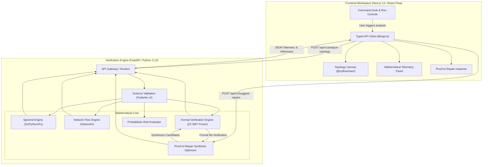

# Katalyst.SMT

> **Formally Verified Infrastructure Resilience & Proof-to-Repair SaaS Engine**

[](https://github.com/katalyst-smt/katalyst-smt/actions/workflows/ci.yml)
[](LICENSE)
[](https://python.org)
[](https://fastapi.tiangolo.com)
[](https://nextjs.org)
[](https://github.com/Z3Prover/z3)

---

## 1. Overview & Problem Definition

Modern cloud-native systems—ranging from Kubernetes service meshes to distributed streaming microservices—frequently suffer catastrophic outages triggered by **correlated, common-mode, and simultaneous node failures** ($k \ge 2$). Ingress controllers, API gateways, database clusters, and processing workers are interconnected by complex directed communication graphs.

Existing resilience engineering relies primarily on **empirical chaos injection** (e.g., Chaos Mesh, Gremlin). While useful, chaos engineering cannot explore the combinatorial $\binom{n}{k}$ space of multi-node failure combinations, leaving catastrophic failure cuts undiscovered until production outages occur.

**Katalyst.SMT** bridges this fundamental gap by combining:
1. **Spectral Graph Theory:** Combinatorial graph Laplacians ($L = D - A$) and algebraic connectivity ($\lambda_2$, the Fiedler value) for continuous structural fabric diagnostics.
2. **Network Flow Duality:** Edmonds-Karp directed maximum flow and minimum cut duality, modeling service concurrency bottlenecks via node-splitting transformations.
3. **Z3 SMT Formal Verification:** Mathematical proofs of $(s, t)$-reachability under arbitrary simultaneous $k$-node failure sets.
4. **The Proof-to-Repair Engine:** An automated differentiator that transforms SMT counterexample witnesses into admissible, cost-optimal topology remediations and formally re-verifies them.

---

## 2. Architecture



---

## 3. Mathematical Foundations

### 3.1 Spectral Graph Theory
* **Combinatorial Laplacian:** $L = D - A$ where $D$ is the diagonal degree matrix and $A$ is the symmetric adjacency matrix using projection $W_{\text{sym}}(u, v) = \max(w(u, v), w(v, u))$.
* **Fiedler Value ($\lambda_2$):** Second-smallest eigenvalue of $L$. Multiplicity of eigenvalue $0$ corresponds to the number of connected components.
* **Normalized Robustness:** $\rho_{\text{spectral}} = \min(1.0, \lambda_2 / |V|)$.

### 3.2 Directed Flow & Cut Duality
* **Max-Flow / Min-Cut Equality:** $\max |f| = \min_{S, T} C(S, T)$.
* **Node Capacities via Node Splitting:** Each vertex $v$ with processing limit $c(v)$ is transformed into $(v_{\text{in}}, v_{\text{out}})$ with capacity $c(v)$.

### 3.3 Z3 SMT Cut-Reachability Encoding
* **Formula:** A failure set $F \subseteq V \setminus \{s, t\}$ disconnects $s$ from $t$ if and only if there exists a partition $S \subseteq V$ such that:
  $$S_s = \text{True} \quad \land \quad S_t = \text{False}$$
  $$\forall u \in V \setminus \{s, t\}: S_u \implies \neg f_u$$
  $$\forall (u, v) \in E: (S_u \land \neg f_v) \implies S_v$$
  $$\sum_{v \in V \setminus \{s, t\}} \text{ite}(f_v, 1, 0) \le k$$
* **Solver Semantics:**
  - **SAT:** Extracted minimal counterexample $F^*$ partitions the network.
  - **UNSAT:** Certified mathematical proof of $k$-fault tolerance (by Menger's theorem, vertex connectivity strictly exceeds $k$).
  - **UNKNOWN:** Reported honestly on timeout.

---

## 4. The Proof-to-Repair Workflow

1. Ingests directed capacitated topology $G = (V, E)$, source $s$, sink $t$, and failure budget $k$.
2. Z3 solver searches for cutting failure set $F^* \subseteq V \setminus \{s, t\}$ of size $\le k$.
3. When SAT, extracts minimal witness nodes and diagnoses root cause cut partition $(S, T)$.
4. Synthesizes admissible candidate remediation edges $(u, v)$ from $u \in S$ to $v \in T$ bypassing $F^*$.
5. Ranks candidates by intervention cost $J(\Delta E)$ and flow enhancement.
6. Re-executes the **exact same Z3 SMT solver** on the proposed topology $G' = G \cup \Delta E^*$.
7. Certifies the repair as **Formally Verified (UNSAT)** and allows 1-click application in the UI canvas.

---

## 5. Quickstart with Docker Compose

To launch the complete application stack locally with zero configuration:

```bash
# Clone the repository
git clone https://github.com/katalyst-smt/katalyst-smt.git
cd katalyst-smt

# Build and start all services
docker compose up --build
```

* **Frontend Workspace:** `http://localhost:3000`
* **FastAPI Backend:** `http://localhost:8000`
* **Interactive API Docs:** `http://localhost:8000/docs`

---

## 6. Manual Local Development

### 6.1 Backend
```bash
cd backend
python -m venv venv
source venv/bin/activate  # Windows: .\venv\Scripts\activate
pip install -r requirements.txt

# Run automated tests
pytest tests/ -v

# Start FastAPI server
uvicorn main:app --reload --port 8000
```

### 6.2 Frontend
```bash
cd frontend
npm install

# Run type check and production build
npm run build

# Start Next.js dev server
npm run dev
```

---

## 7. Sample API Usage

### Analyze Topology
```bash
curl -X POST "http://localhost:8000/api/v1/analyze-topology" \
  -H "Content-Type: application/json" \
  -d '{
    "topology": {
      "nodes": [
        {"id": "ingress", "label": "Envoy Ingress"},
        {"id": "gateway", "label": "API Gateway"},
        {"id": "database", "label": "PostgreSQL"}
      ],
      "edges": [
        {"source": "ingress", "target": "gateway", "capacity": 50.0},
        {"source": "gateway", "target": "database", "capacity": 50.0}
      ],
      "source_node_id": "ingress",
      "sink_node_id": "database"
    },
    "config": {
      "failure_k": 1,
      "failure_mode": "at_most"
    }
  }'
```

**Response:**
```json
{
  "topology_summary": {
    "node_count": 3,
    "edge_count": 2,
    "source": "ingress",
    "sink": "database",
    "failure_k": 1
  },
  "spectral": {
    "fiedler_value": 1.0,
    "algebraic_connectivity_score": 0.333,
    "num_connected_components": 1
  },
  "flow": {
    "max_throughput": 50.0,
    "min_cut_capacity": 50.0,
    "duality_verified": true
  },
  "verification": {
    "status": "SAT",
    "is_resilient": false,
    "counterexample_nodes": ["gateway"],
    "witness_description": "Counterexample identified: Failure of nodes [gateway] completely partitions sink from source."
  }
}
```

---

## 8. Automated Testing & Verification

Katalyst.SMT adheres to a **Zero-Known-Defect standard**:
* **27 unit and integration tests** executed across spectral analysis, flow conservation, Z3 SMT solvers, and API endpoints.
* **Double-blind cross-validation:** Solver output is verified against ground-truth exhaustive combinatorial enumeration using NetworkX.

```bash
cd backend
pytest tests/ -v
# Result: 27 passed in 1.12s
```

---

## 9. License

Katalyst.SMT is licensed under the [Apache License 2.0](LICENSE).
