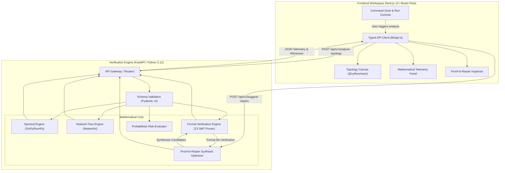
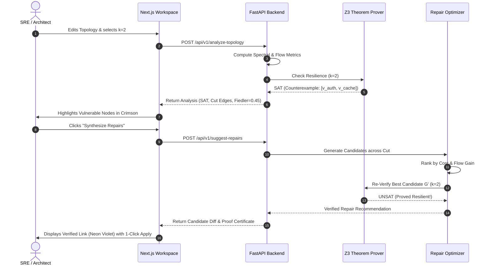

# System Architecture: Katalyst.SMT

## 1. System Overview

Katalyst.SMT is architected as a high-performance, decoupled resilience engineering platform comprising a scientific computing verification backend (FastAPI, NetworkX, SciPy, Z3 SMT) and a dense, developer-first technical workspace frontend (Next.js 14, React Flow, Tailwind CSS, Framer Motion).



---

## 2. Backend Module Decomposition

The backend is cleanly structured into decoupled, single-responsibility modules:

```text
backend/
├── main.py                    # Application entrypoint, CORS, lifespan, OpenAPI config
├── requirements.txt           # Pinned, reproducible production dependencies
├── Dockerfile                 # Minimal, multi-stage production container
├── app/
│   ├── __init__.py
│   ├── config.py              # Environment variables, CORS origins, timeouts
│   ├── schemas.py             # Strict Pydantic models for graph input/output
│   ├── graph_engine.py        # Graph validation, cycle detection, transformations
│   ├── spectral_analysis.py   # Adjacency, degree, Laplacian, eigh, Fiedler value
│   ├── flow_analysis.py       # Directed max-flow, min-cut, node splitting
│   ├── formal_verification.py # Z3 SMT bounded rank reachability, counterexample extraction
│   ├── repair_engine.py       # Admissible candidate generation, cost optimizer, re-verification
│   └── risk_model.py          # Independent & joint failure probability calculator
└── tests/
    ├── test_health.py
    ├── test_validation.py
    ├── test_spectral_analysis.py
    ├── test_flow_analysis.py
    ├── test_formal_verification.py
    ├── test_repair_engine.py
    └── test_analyze_topology.py
```

### 2.1 Backend Separation of Concerns
1. `schemas.py`: Reusable data contracts. Nodes and edges use immutable UUID/string IDs. Rejects non-numeric capacities, negative weights, probabilities outside $[0, 1]$, and undefined source/sink IDs.
2. `graph_engine.py`: Encapsulates topological transformations (e.g., node-splitting for node capacity bounds, symmetric projection).
3. `spectral_analysis.py`: Pure numpy/scipy operations. Computes $A, D, L$ and $\lambda_2$.
4. `flow_analysis.py`: Direct NetworkX graph construction. Computes $(s, t)$ maximum flow, minimum cut, and critical bottleneck edges.
5. `formal_verification.py`: Direct Z3 AST construction. Formulates the bounded rank reachability theorem and queries the solver for minimal counterexamples.
6. `repair_engine.py`: Bridges vulnerability discovery to repair. Analyzes cut partitions, synthesizes admissible edge candidates, minimizes cost, and re-invokes `formal_verification.py` to prove UNSAT.

---

## 3. Frontend Architecture

The frontend is styled after **Blackbox.ai**'s technical workspace: `#000000` pitch black background, `#0A0A0A` panels, 10% opacity white borders, Cybernetic Violet (`#8B5CF6`) and Neon Blue (`#3B82F6`) accents, technical monospace telemetry, and high information density.

```text
frontend/
├── package.json
├── tsconfig.json
├── next.config.js
├── tailwind.config.js
├── Dockerfile
└── src/
    ├── app/
    │   ├── layout.tsx         # Root layout with fonts, theme wrapper
    │   ├── page.tsx           # Primary workspace layout integrating canvas and dock
    │   ├── globals.css        # Tailwind directives, custom scrollbars, dark mode tokens
    │   └── error.tsx          # Error boundary
    ├── components/
    │   ├── AppHeader.tsx      # System status, latency, API connection badge
    │   ├── AppSidebar.tsx     # Topology presets, import/export, history
    │   ├── TopologyCanvas.tsx # @xyflow/react canvas with custom nodes/edges
    │   ├── NodeInspector.tsx  # Interactive properties drawer (capacity, failure prob)
    │   ├── MathTelemetryPanel.tsx # Spectral matrices, flow, and SMT proofs
    │   ├── CommandDock.tsx    # Floating execution bar with k selector and run trigger
    │   ├── RepairModal.tsx    # Proof-to-Repair candidate browser and diff viewer
    │   └── LoadingSkeleton.tsx# Skeletal loading states
    └── lib/
        ├── api.ts             # Strongly typed Axios/Fetch API client
        ├── types.ts           # Shared TypeScript interfaces mirroring Pydantic schemas
        ├── sample-topologies.ts# Realistic cloud architectures (Microservices, E-commerce, K8s)
        └── validation.ts      # Client-side topology preflight validation
```

---

## 4. End-to-End Proof-to-Repair Lifecycle


